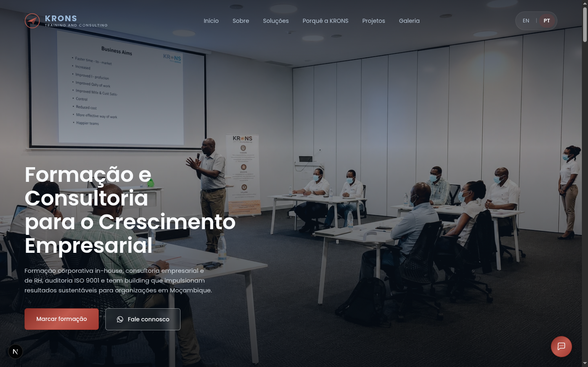
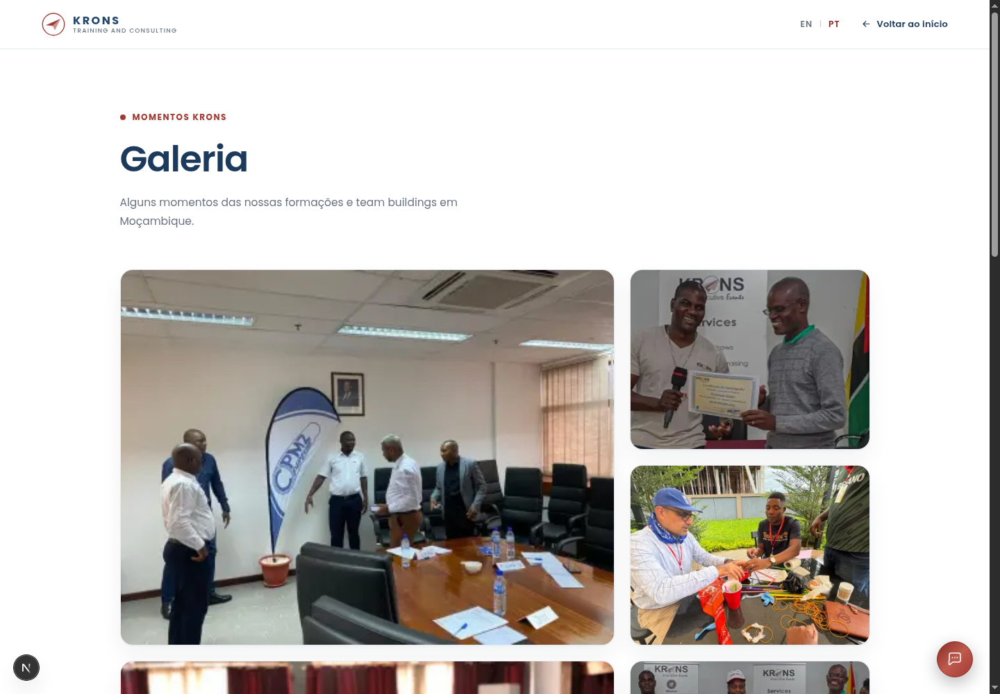
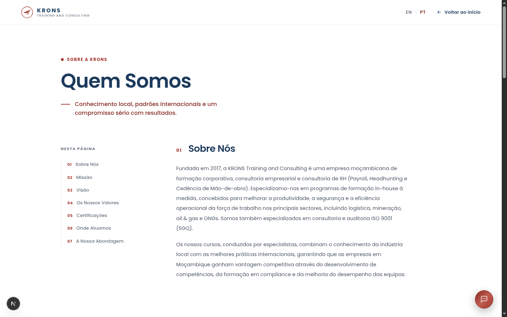

# KRONS Training and Consulting — Website


Site institucional da **KRONS Training and Consulting** (Beira, Moçambique,
desde 2017): formação corporativa, consultoria empresarial e de RH, auditoria
ISO 9001 e team building.

Construído com **Next.js 16 (App Router, Turbopack)** e **React 19**, com CSS
Modules, i18n PT/EN próprio, animações de reveal ao scroll, um assistente
virtual baseado em regras e uma galeria de fotos em mosaico.

> 🔒 **Repositório privado** — propriedade da KRONS Training and Consulting.
> Todos os direitos reservados, ver [LICENSE](LICENSE). Uso restrito à
> equipa interna e a colaboradores autorizados; não é um projeto
> open-source e não aceita contribuições externas.

---

## Índice

- [Screenshots](#screenshots)
- [Funcionalidades](#funcionalidades)
- [Tecnologias](#tecnologias)
- [Arquitetura](#arquitetura)
- [Estrutura de pastas](#estrutura-de-pastas)
- [Instalação](#instalação)
- [Configuração e variáveis de ambiente](#configuração-e-variáveis-de-ambiente)
- [Desenvolvimento](#desenvolvimento)
- [Build de produção](#build-de-produção)
- [Docker](#docker)
- [Testes](#testes)
- [Deploy](#deploy)
- [Design system](#design-system)
- [FAQ](#faq)
- [Roadmap](#roadmap)
- [Licença](#licença)
- [Autor e contacto](#autor-e-contacto)

---

## Screenshots

| Homepage                                        | Galeria                                  | Quem Somos                                |
| ----------------------------------------------- | ---------------------------------------- | ----------------------------------------- |
|  |  |  |

## Funcionalidades

- **Bilingue PT/EN** com troca instantânea (sem reload), fonte única de
  conteúdo em `content/pt.json` / `content/en.json`.
- **Homepage** com Hero, Sobre, grelha de Soluções, linha do tempo "Porquê a
  KRONS", estudos de caso com slider de fotos, testemunhos, FAQ e parceiros.
- **Página "Quem Somos"** em formato documentação, com índice lateral e
  scroll-spy.
- **Subpáginas de atividades** (`/atividades/[slug]`), geradas estaticamente.
- **Galeria de fotos** (`/galeria`) em mosaico "bento" com lightbox.
- **Assistente virtual (chatbot)** flutuante, baseado em regras — responde
  apenas com informação já publicada no site, nunca inventa dados; encaminha
  para o WhatsApp quando não sabe a resposta.
- **Botão de WhatsApp** uniformizado, com mensagem pré-definida por contexto
  (Hero, Sobre, cada atividade).
- **SEO**: Open Graph, Twitter Card, `robots.txt`, `sitemap.xml`,
  `manifest.webmanifest`, `metadataBase`.
- **Animações de scroll-reveal** que respeitam `prefers-reduced-motion`.
- **Imagens otimizadas**: todas em WebP, servidas via `next/image`.

## Tecnologias

| Categoria            | Escolha                                               |
| -------------------- | ----------------------------------------------------- |
| Framework            | Next.js 16 (App Router, Turbopack)                    |
| UI                   | React 19                                              |
| Estilos              | CSS Modules (sem Tailwind)                            |
| Linguagem            | JavaScript (sem TypeScript — ver [Roadmap](#roadmap)) |
| Lint / formatação    | ESLint (`eslint-config-next`) + Prettier              |
| Git hooks            | Husky + lint-staged                                   |
| Containerização      | Docker (multi-stage) + Docker Compose                 |
| Hospedagem sugerida  | Qualquer plataforma Node.js/Docker, ou Vercel         |
| Base de dados / Auth | Nenhuma — site estático sem backend                   |

## Arquitetura

Ver [docs/architecture.md](docs/architecture.md) para o diagrama completo,
rotas, i18n e convenções de componentes/hooks.

## Estrutura de pastas

```
content/
  pt.json              # todo o conteúdo em português (fonte de verdade editorial)
  en.json              # tradução inglesa (mesma estrutura de chaves)
docs/                  # documentação técnica (arquitetura, deploy, docker, FAQ...)
src/
  app/                 # rotas do App Router (layout, páginas, metadata routes)
  assets/              # imagens locais (WebP, importadas estaticamente)
  components/          # um componente por pasta (Componente.jsx + .module.css)
  hooks/               # lógica reutilizável (useRevealOnScroll, useScrollDirection)
  i18n/                # LanguageContext (provider PT/EN)
  utils/               # helpers (smoothScroll, faqTopics)
public/                # assets estáticos servidos diretamente (og-image.jpg)
.github/               # CI (build/lint) e Dependabot
Dockerfile, docker-compose.yml, .dockerignore
```

## Instalação

```bash
git clone <url-do-repositorio>
cd uzoman-2pages
npm install
npm run dev
```

Ver [docs/installation.md](docs/installation.md) para o guia completo e a
lista de scripts disponíveis.

## Configuração e variáveis de ambiente

**Não há segredos nem chaves de API neste projeto.** Ver
[.env.example](.env.example) e
[docs/environment-variables.md](docs/environment-variables.md).

## Desenvolvimento

```bash
npm run dev
```

Abre [http://localhost:3000](http://localhost:3000). Turbopack recompila
automaticamente ao gravar ficheiros.

## Build de produção

```bash
npm run build
npm start
```

`next.config.mjs` usa `output: 'standalone'`, gerando um servidor mínimo
autossuficiente (usado também pela imagem Docker).

## Docker

```bash
docker compose up -d --build
```

Ver [docs/docker.md](docs/docker.md) para detalhes do `Dockerfile`
multi-stage e variáveis de runtime.

## Testes

Este projeto **não tem, atualmente, um framework de testes configurado**
(sem Jest/Vitest/Playwright) — é um site institucional sem lógica de negócio
complexa, verificado através de `npm run lint`, `npm run build` e testes
manuais no browser antes de cada alteração. Ver
[Roadmap](#roadmap) para planos futuros nesta área.

## Deploy

Ver [docs/deploy.md](docs/deploy.md) — funciona em Docker/VPS próprio, Vercel
ou qualquer plataforma Node.js, sem configuração adicional.

## Design system

Tokens de cor e tipografia centralizados em `src/app/globals.css` (`:root`):

- **Azul da marca** — `--brand-blue: #24476b`.
- **Vermelho de destaque** — família `--accent` (`#a23a32`).
- **Superfícies** — `--surface: #ffffff`, `--ink: #152638`, `--cream: #f8fafc`.
- Tipografia: Poppins. Reveals com `cubic-bezier(0.16, 1, 0.3, 1)` via
  `IntersectionObserver`, respeitando `prefers-reduced-motion`.

## FAQ

Ver [docs/faq.md](docs/faq.md) para perguntas frequentes sobre o próprio
repositório (não confundir com a FAQ _do site_, em `content/pt.json` →
chave `faq`).

Para problemas comuns (build, lint, Docker, screenshots headless), ver
[docs/troubleshooting.md](docs/troubleshooting.md).

## Roadmap

Sugestões de evolução futura, não planeadas nem em curso:

- [ ] Migração gradual para TypeScript (começando pelos hooks e utils)
- [ ] Suite de testes (Vitest + Testing Library para componentes-chave)
- [ ] Migração de CSS Modules para Tailwind CSS, se a equipa preferir
- [ ] CMS headless para o conteúdo, em vez de `content/*.json` editado à mão
- [ ] Analytics de conversão nos CTAs de WhatsApp

## Licença

Todos os direitos reservados — ver [LICENSE](LICENSE). Este é um repositório
**privado**: o código e o conteúdo pertencem à KRONS Training and Consulting
e não podem ser reutilizados, copiados ou distribuídos por terceiros.

## Autor e contacto

**KRONS Training and Consulting** — Av. FPLM, Bairro Palmeiras, Beira,
Moçambique.

- Website: [kronsconsulting.co.mz](https://kronsconsulting.co.mz)
- Email: geral@kronslda.com
- WhatsApp: +258 86 822 3444

Acesso e dúvidas técnicas sobre este repositório: contactar a equipa
internamente, através dos canais acima.
